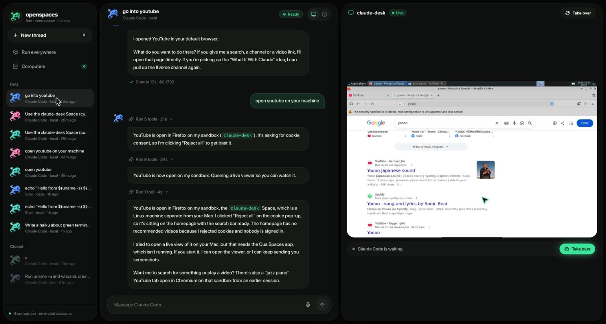
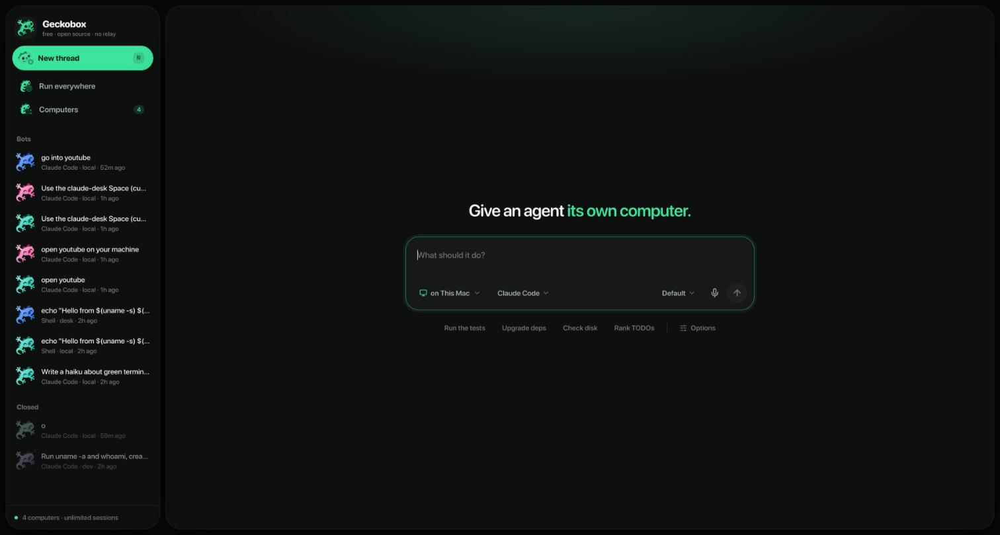
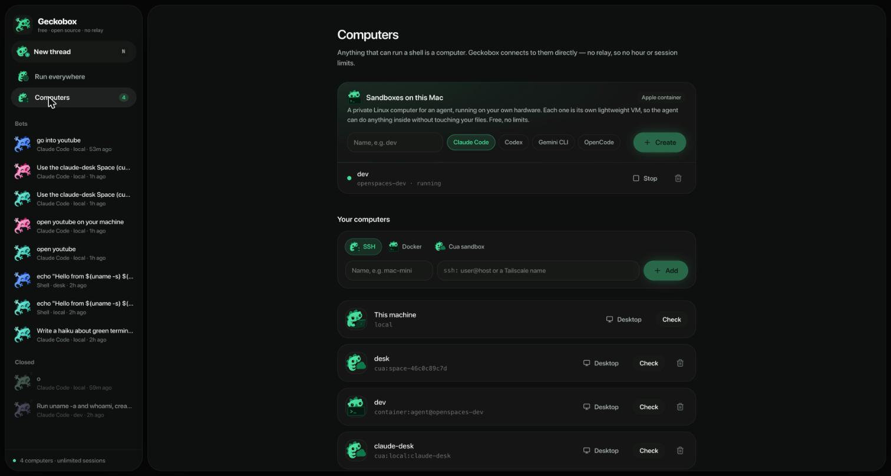
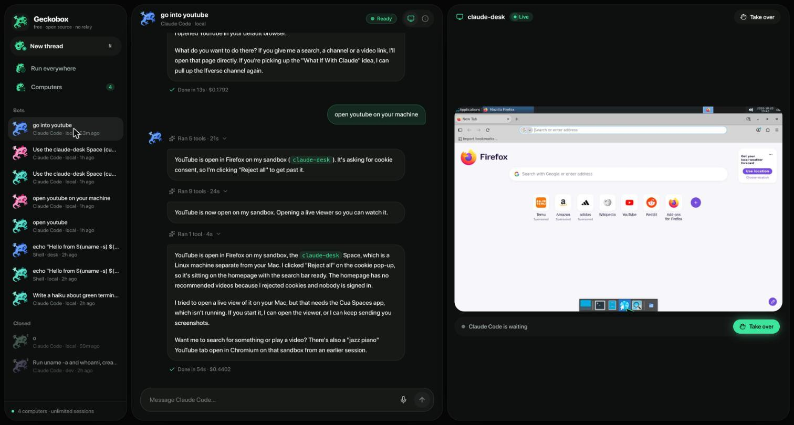
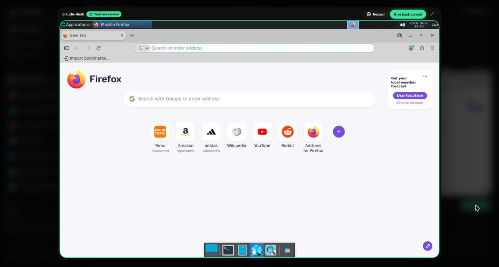
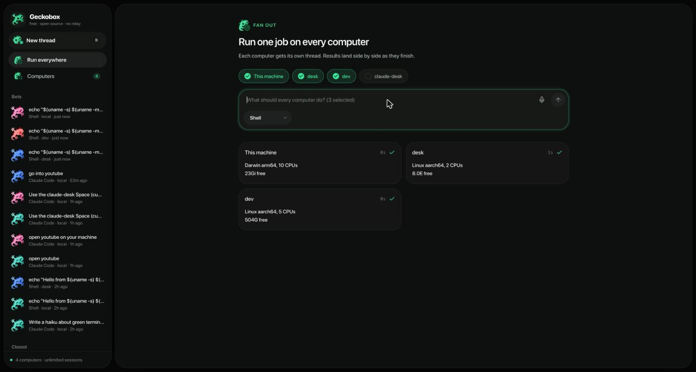
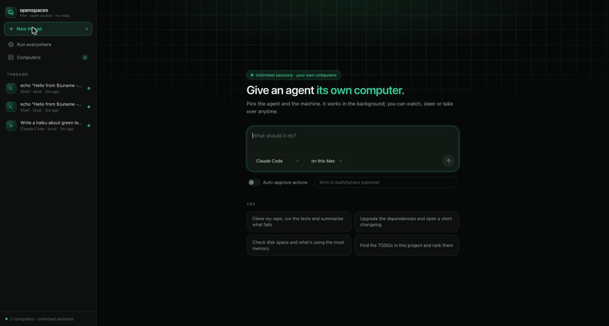

# Geckobox

<sub>The command-line tool and SDK are called `openspaces`.</sub>

Put Claude Code, Codex or any coding agent on a computer you choose, and run jobs across all your computers at once. **Free, with no limits.**

The "bring your own computer" idea from [Cua Spaces](https://x.com/trycua/status/2112228154651881479), without the meter:

- **Live sessions:** Cua Free 2, Pro 5. Geckobox: unlimited.
- **Remote hours a month:** Cua Free 20, Pro 200. Geckobox: unlimited.
- **Account:** Cua needs one for remote use. Geckobox needs none.
- **Licence:** Cua is FSL-1.1. Geckobox is MIT.

Cua meters its relay. openspaces has no relay: it reaches your computers directly. They can be sandboxes it creates on your own machine, any box over SSH ([Tailscale](https://tailscale.com) handles NAT), Docker, or a Cua sandbox. With no middleman there is nothing to meter. It is an independent clean-room implementation, not affiliated with Cua; none of its code comes from Cua.



## Quick tour

**1. Say what to do, pick the computer, agent and model.**



**2. Add computers: sandboxes on your Mac in ~20 s, or any machine over SSH, Docker or Cua.**



**3. Watch the agent work live, next to the chat.**



**4. Take over anytime: click, scroll and type into its computer, or record it.**



**5. Run one job on every computer at once.**



**➜ Full step-by-step guide: [docs/TUTORIAL.md](docs/TUTORIAL.md)**

## The app

```sh
npm install -g github:migasrias2/geckobox
openspaces ui
```

A local dashboard opens in your browser: dark, green, rounded and calm, inspired by Grok Bot's layout (bots on the left, the conversation in the middle, the bot's computer live on the right).

- **New thread:** pick an agent and a computer, say what to do, and it runs in the background.
- **Threads:** a chat with each agent beside a **live view of its computer**. You see the screen, the agent's cursor gliding and a ripple wherever it clicks, at about 3 fps, all inside the app. **Take over** goes full screen and sends your clicks, scrolls and typing to that computer. Pause hands control back and forth.
- **Bots with faces:** each agent has an animated face that blinks when idle, glances around while working and smiles when done.
- **Run everywhere:** one job on several computers at once, with results side by side.
- **Computers:** create sandboxes, add SSH, Docker or Cua machines, check which agents each has, and watch any desktop live.
- **"Let it use computers (Cua)"** pre-approves only Cua's tools on your Mac (Claude Code `--allowedTools mcp__cua`), so an agent can drive a sandbox's browser without approving everything.

It runs on `127.0.0.1` only, behind a random token in the link the command prints, and it rejects other hosts, so other websites can't drive it.



## SDK in ten lines

```ts
import { startThread } from "openspaces"

const bot = await startThread({
  agent: "claude-code",
  prompt: "Open the repo and run the tests",
  on: "local",            // or "mac-mini", "ssh:me@box", "docker:dev", "cua:desk"
})
console.log(await bot.wait())
console.log(await bot.send("Now fix the failing test"))   // same agent session, it remembers
console.log(await bot.status())
await bot.close()
```

Change `on: "local"` to the name of another of your computers and the job runs there instead.

## Sandboxes on your own machine

```sh
brew install container && container system start   # macOS 26: Apple's open-source runtime (or use Docker/Podman)
openspaces sandbox create dev                       # ~20 s: an isolated Linux VM with Claude Code installed
openspaces start --on dev "clone my repo and fix the failing test"
```

Each sandbox is its own lightweight VM with Apple's `container` runtime, or a container with Docker or Podman. The agent runs inside as an unprivileged `agent` user with permission prompts skipped. It can do anything inside the box and nothing outside it. `--agents claude-code,codex,gemini,opencode` picks what gets installed, and `--cpus` / `--memory` size it. `openspaces sandbox ls | stop | start | rm` manages them. The app has a "Sandboxes on this Mac" panel that does the same.

**Logging the agent in:** a sandbox forwards the agent's login variable (`CLAUDE_CODE_OAUTH_TOKEN` or `ANTHROPIC_API_KEY` for Claude Code) from your shell, or from the macOS Keychain:

```sh
claude setup-token                                  # prints a long-lived subscription token
openspaces secrets set CLAUDE_CODE_OAUTH_TOKEN      # paste it; stored in the Keychain (account "openspaces")
```

Secrets reach the sandbox over stdin, never in argv, and are never written to openspaces' state or logs.

## How it works

A **computer** is anything that can run a shell script:

- `local`: this machine
- `ssh:user@host`: any machine you can SSH into (Mac mini, VPS, your own AWS/GCP/Azure box)
- `container:[user@]name`, `docker:…`, `podman:…`: a running container (sandboxes register themselves this way)
- `cua:sandbox`: a [Cua](https://github.com/trycua/cua) sandbox, through `cua sandbox exec`

A **thread** is one agent conversation on one computer. Each turn runs the agent headless in its own work dir on that computer (`~/.openspaces/work/<thread>`). The agent's session id is saved, so the next message resumes the same conversation. Thread state lives in `~/.openspaces/threads/` on the machine you drive it from. There is nothing to install on the target except the agent CLI itself. No daemon, no account, no relay.

## Agents

- `claude-code`: `claude -p --output-format stream-json`, resumed with `--resume`. **Tested live.**
- `shell`: the prompt is a shell script; good for jobs and smoke tests. **Tested live.**
- `codex`: `codex exec --json`, resumed with `codex exec resume`. Written from the CLI docs, not yet live-tested.
- `gemini`: `gemini -p --output-format stream-json`, resumed with `--resume`. Not yet live-tested.
- `opencode`: `opencode run --format json`, resumed with `--session`. Not yet live-tested.

Adding an agent is one small file: build its argv and map its output lines to events (`src/agents/`). PRs welcome, especially live-tested fixes for the three untested adapters.

## CLI

```sh

openspaces computers add mini ssh:me@mac-mini.local
openspaces computers test mini             # reachable? which agents are installed?

openspaces start --on mini "Upgrade the deps and run the tests"   # prints a thread id, runs in the background
openspaces logs <id> -f                    # watch messages and tool calls
openspaces send <id> --wait "Now open a PR"
openspaces status                          # every thread, every computer
openspaces close <id>                      # stops it and deletes its work dir

# the same job on several computers at once
openspaces run --on local,mini,docker:ci "Run the test suite and summarise failures"
```

Options: `--agent`, `--cwd /abs/path` (work in an existing repo; never deleted), `--keep`, `--model`, `--env NAME` (forward a variable such as `CLAUDE_CODE_OAUTH_TOKEN`), `--auto-approve` / `--no-auto-approve`. See `openspaces --help`.

## SDK

```ts
import { fanOut, openThread, startThread } from "openspaces"

// Same job everywhere, results side by side.
const results = await fanOut(["local", "mini", "cua:desk"], {
  agent: "claude-code",
  prompt: "What OS are you on and how much disk is free?",
})

// Stream what the agent does.
const bot = await startThread({ agent: "claude-code", prompt: "…", onEvent: (e) => console.log(e) })

// Pick up a thread started elsewhere (for example from the CLI).
await openThread("claudecode-94419f2a").send("Carry on")
```

## Watch and take over

```sh
openspaces view mini            # SSH tunnel to the Mac's Screen Sharing (VNC :5900), opens it; Ctrl-C closes
openspaces view mini --port 5901
openspaces view cua:desk        # Cua's own local viewer (loopback, no relay); the app streams it inline
```

On a Mac, turn on System Settings → General → Sharing → Screen Sharing. On Linux, run any VNC server bound to localhost. The tunnel goes over the same SSH you already use, so nothing new is exposed.

Thread methods: `wait()`, `send(prompt)`, `status()`, `interrupt()` (stops the turn and every child process, keeps the thread), `close()`.

## Safety

- **Permission prompts.** Agents run headless and can't ask you anything mid-turn. By default, permission prompts are skipped only on isolated computers (`docker:` and `cua:`). On `local` and `ssh:` Claude Code gets `--permission-mode acceptEdits`: file edits are auto-approved, and other tools follow Claude Code's own permission rules (anything that would normally ask is denied). Pass `--auto-approve` when you trust the box.
- **Secrets.** Forwarded env vars reach `local`, `ssh` and `docker` over stdin, never in argv, and are never written to thread state or logs. Cua's `sandbox exec` cannot take stdin, so there they pass as an argument on your own machine.
- **Cleanup.** `close` deletes only `~/.openspaces/work/<thread>` on the target, never a `--cwd` you passed. A turn's pid file exists only while it runs, and `close` only kills a process it can confirm is that thread's worker.
- **Local state** (`~/.openspaces/threads`) holds prompts and agent output and is readable only by you (0700/0600).

## Not here (yet)

- **Hosted relay:** use Tailscale (free for personal use) or plain SSH instead.
- **Share links and team roles:** add teammates as SSH users, or share the machine on your tailnet.
- **Saved sign-ins (keyvault, teleport):** not yet.
- **A native Mac and iPhone app:** not yet. The dashboard is a local web app (`openspaces ui`).

## Develop

```sh
npm install
npm test            # unit, in-process threads, the HTTP API, and the built CLI end to end
npm run dev:ui      # UI with hot reload (proxying to `openspaces ui --port 4600`)
npm run typecheck
```

## License

MIT © Miguel Fortes Martins
